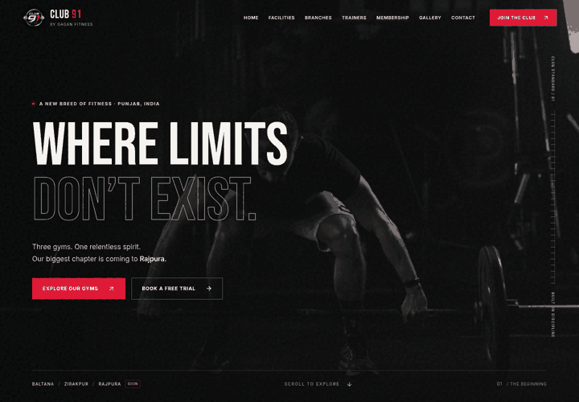
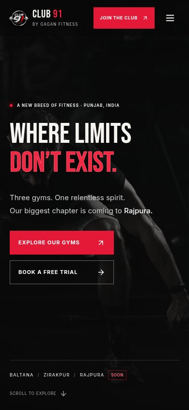
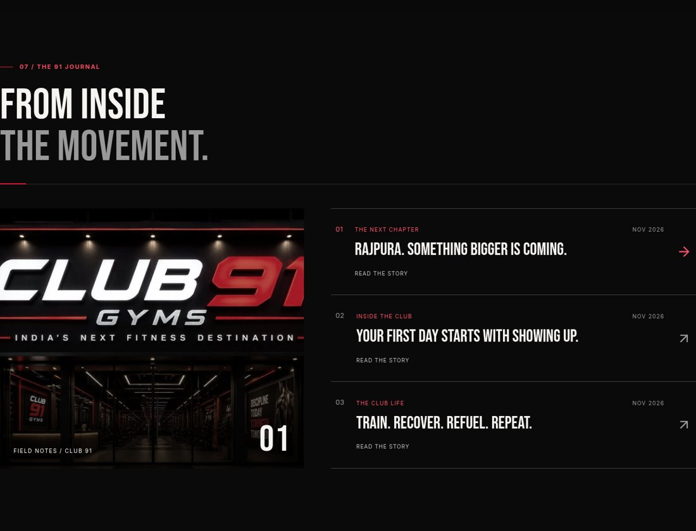
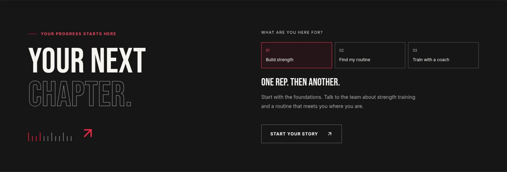

# Club 91 design preview

Captured from the production static export in Chromium. The hero GIF samples the actual CSS animation timeline; it loops for review, while the website plays the sequence once per page load. The mobile still shows the reduced-motion, settled title.

Validation: production build, TypeScript, and all nine Playwright tests passed. Layouts checked at 320, 390, 768, 1024 and 1440 CSS pixels. Native dialogs, keyboard interactions, form handoff and reduced motion are covered. Business preview labels remain in place.
